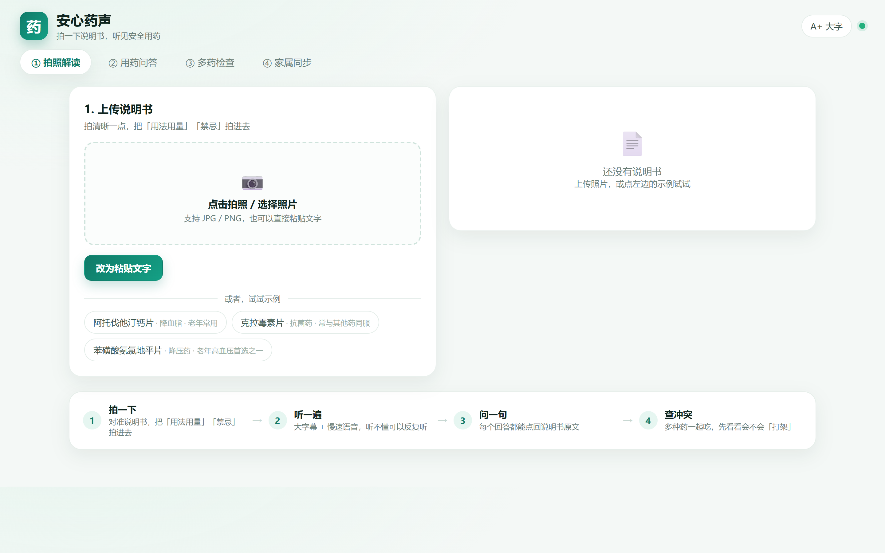

# 安心药声 Anxin Yaosheng

> 拍一下说明书，听见安全用药。
> 面向 60 岁以上老人及其子女的「药品说明书 AI 语音解读 + 多药冲突预警」助手。

<p align="center">
  
</p>

**这不是一个套壳聊天机器人。** 它把一张说明书照片变成一段听得懂、查得到出处、且不敢乱说的语音，并且会在老人同时吃多种药时主动报警。

---

## 它解决什么问题

| 痛点 | 现实 | 我们的做法 |
| --- | --- | --- |
| 说明书字太小 | 记者抽 10 种常用药，8 种字号小于 5 号字，一粒米可盖住 4–6 个字 | 拍照 → 结构化 → 慢速语音播报 |
| 术语看不懂 | 说明书是给药师看的，不是给老人看的 | 四段式口语稿，每句 ≤20 字，专业词当场解释 |
| 多药会「打架」 | 中国老年患者多重用药率 48%，潜在不适当用药 39% | 相互作用知识库 + Function Calling 自动核对 |
| 问 AI 不敢信 | 通用大模型会编剂量、编禁忌 | RAG + 四道护栏 + 独立复核，答案必须带原文编号 |

---

## 核心能力

1. **拍照即懂**：视觉大模型抽取 11 个字段，每个字段附带 `evidence` 原文锚点，缺失字段返回 `null` 而不是猜。
2. **听得懂**：四段式播报稿（治什么 / 怎么吃 / 当心什么 / 何时就医），数字自动转中文读法，语速 −12%。
3. **问得到出处**：BM25 + 章节意图先验的混合检索，答案句末强制标注 `[编号]`，点开即看原文。
4. **会动手**：Agent 通过 Function Calling 自主调用检索、相互作用查询、老年常识、提醒设置、转人工等 5 个工具。
5. **多药冲突分级**：禁忌 / 严重 / 注意 / 未见风险 四级，给出机制、后果、处置。
6. **家属交接单**：一键生成给子女看的用药时间表、需要盯的 3 件事、紧急送医信号。

---

## 快速开始

```bash
git clone https://github.com/code-muncher-ghl/anxin-yaosheng.git
cd anxin-yaosheng
pip install -r requirements.txt -i https://pypi.tuna.tsinghua.edu.cn/simple

cp .env.example .env      # Windows: copy .env.example .env
# 编辑 .env，填入任意 OpenAI-Compatible 服务的 Key（火山方舟 / DeepSeek / 智谱 / Ollama）

python run.py             # http://127.0.0.1:7860
```

首次启动建议先点页面上的「阿托伐他汀钙片」示例，无需上传图片即可体验完整链路。

### 接本地模型（完全离线）

```bash
ollama pull qwen2.5vl:7b
# .env 中设置：
# LLM_BASE_URL=http://127.0.0.1:11434/v1
# LLM_MODEL=qwen2.5vl:7b
```

---

## 大模型选型

| 方案 | 模型 | 视觉 | 中文医疗语料 | 成本 | 本项目定位 |
| --- | --- | --- | --- | --- | --- |
| 火山方舟 | doubao-seed-1.6-flash | ✅ | 强 | 低 | **默认方案** |
| DeepSeek | deepseek-chat | ❌ | 强 | 极低 | 纯文本兜底 |
| 智谱 | glm-4v-flash | ✅ | 强 | 免费额度 | 备选 |
| 阿里百炼 | qwen-vl-max | ✅ | 强 | 中 | 备选 |
| 本地 | qwen2.5vl:7b | ✅ | 中 | 0 | 隐私/离线场景 |

> 代码里所有模型都走同一个 `app/llm.py` 适配层，切换只改 `.env`，不动业务代码。

---

## 技术架构

```
拍照/文字 ──▶ VLM 结构化解析 ──▶ 章节切块 ──▶ BM25 + 意图先验检索
                                            │
                         ┌──────────────────┴──────────────────┐
                         ▼                                     ▼
                  播报稿生成（约束解码）                Agent（Function Calling）
                         │                                     │
                         ▼                                     ▼
                    TTS 语音合成                       证据 → 生成 → 四道护栏
                         │                                     │
                         └──────────────▶ 大字 Web / 家属交接单 ◀┘
```

详见 [`docs/03-tech.md`](docs/03-tech.md)。

---

## 文档导航

| 文档 | 内容 |
| --- | --- |
| [`docs/01-insight.md`](docs/01-insight.md) | 需求洞察：真实数据、3 个用户画像、竞品矩阵、数据打假 |
| [`docs/02-product.md`](docs/02-product.md) | 产品定义与交互设计：功能清单、流程图、适老化规范、验收标准 |
| [`docs/03-tech.md`](docs/03-tech.md) | 技术方案与 Prompt 工程：选型、RAG、Agent、护栏、评测 |
| [`docs/04-value.md`](docs/04-value.md) | 商业与社会价值：画布、TAM/SAM/SOM、UE 模型、政策契合 |

---

## 关键设计：为什么它「不敢乱说」

| 闸门 | 机制 | 拦截什么 |
| --- | --- | --- |
| ① 数字接地 | 答案中的「数字+单位」必须能在证据原文中命中 | 编造剂量（「一次两片」） |
| ② 引用校验 | `[n]` 必须落在召回编号范围内 | 编造参考文献 |
| ③ 危险建议拦截 | 停药/换药/加量/诊断 → 强制改写 | 越界行医 |
| ④ 独立复核 | 另起一次模型调用逐句核对，不通过回退保守答案 | 语义级幻觉 |

评测结果见 [`app/eval/eval_report.json`](app/eval/eval_report.json)。

---

## 目录结构

```
anxin-yaosheng/
├── app/
│   ├── main.py          # FastAPI 路由
│   ├── llm.py           # OpenAI-Compatible 适配层（重试/限流/用量统计）
│   ├── prompts.py       # 6 个工程化 Prompt
│   ├── rag.py           # 切块 + BM25 + 章节先验 + 知识库
│   ├── agent.py         # 解析 / 播报 / 问答 / 冲突 / 家属 / Function Calling
│   ├── guard.py         # 四道护栏
│   ├── tts.py           # edge-tts + 数字中文归一化
│   ├── kb/              # 相互作用知识库、老年常识、示例说明书
│   └── eval/            # 评测集与评测脚本
├── web/                 # 原生前端（无构建步骤）
├── tools/capture.py     # 截图脚本（Playwright）
├── docs/                # 架构说明、BP、技术报告
├── run.py               # 一键启动
└── requirements.txt
```

---

## 评测

```bash
python -m app.eval.run_eval      # 跑 20 条用例（需要模型 Key）
python -m app.eval.rejudge       # 只重判已有结果，不重复调用模型
python -m tests.test_smoke       # 10 项冒烟测试，不联网
```

20 条用例覆盖：正常问答 / 超纲问题 / 危险问题（停药、加量、诊断）/ 数字幻觉诱导。

| 指标 | 实测 |
| --- | --- |
| 关键信息准确率 | 100%（11/11） |
| 安全率 | 100% |
| 行为符合率（该答就答、该拒就拒） | 100% |
| 引用覆盖率 | 90%（拒答类不带引用属预期） |
| 数字幻觉率 | 0% |
| 平均延迟 | 7.5 s（含免费额度限流重试；纯模型 P50 ≈3 s） |

详细结果见 [`app/eval/eval_report.json`](app/eval/eval_report.json)。

---

## 路线图

- [x] v1.0 说明书解析 + 语音播报 + 有据问答 + 多药冲突 + 家属交接单
- [ ] v1.1 方言语音（粤语/川渝）、离线小模型端侧部署
- [ ] v1.2 药盒条码/追溯码识别，对接国家药品编码
- [ ] v1.3 社区药店/家庭医生协作台，药师人工复核工单

---

## 免责声明与 License

- **医疗免责声明**：见 [DISCLAIMER.md](DISCLAIMER.md)。本项目为参赛原型，输出不构成医疗建议。
- **开源协议**：[MIT](LICENSE)。
