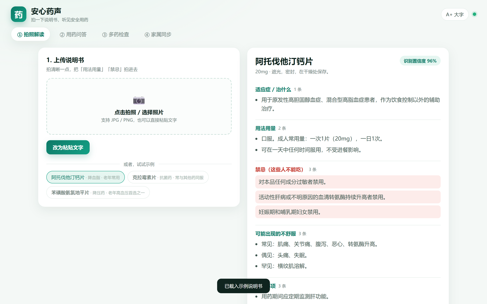
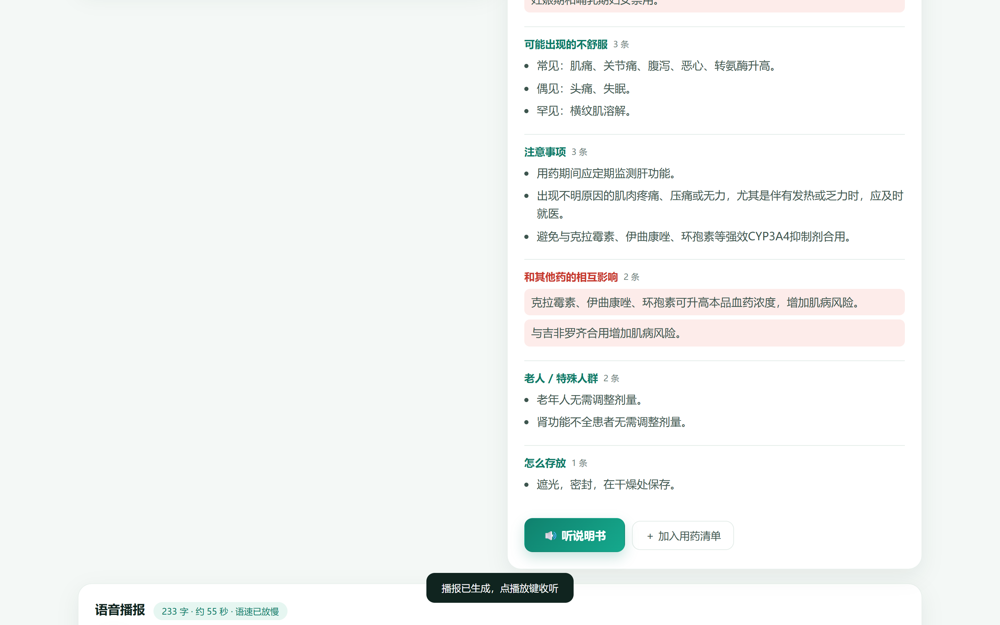
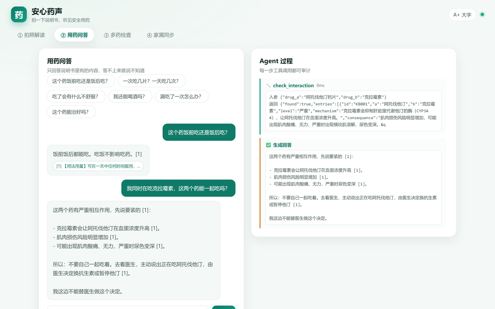
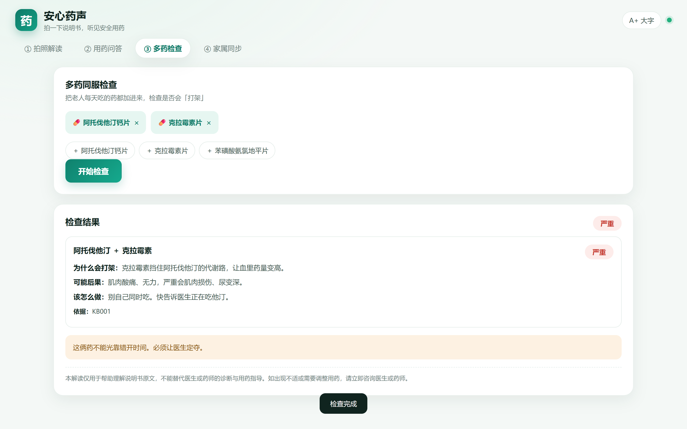
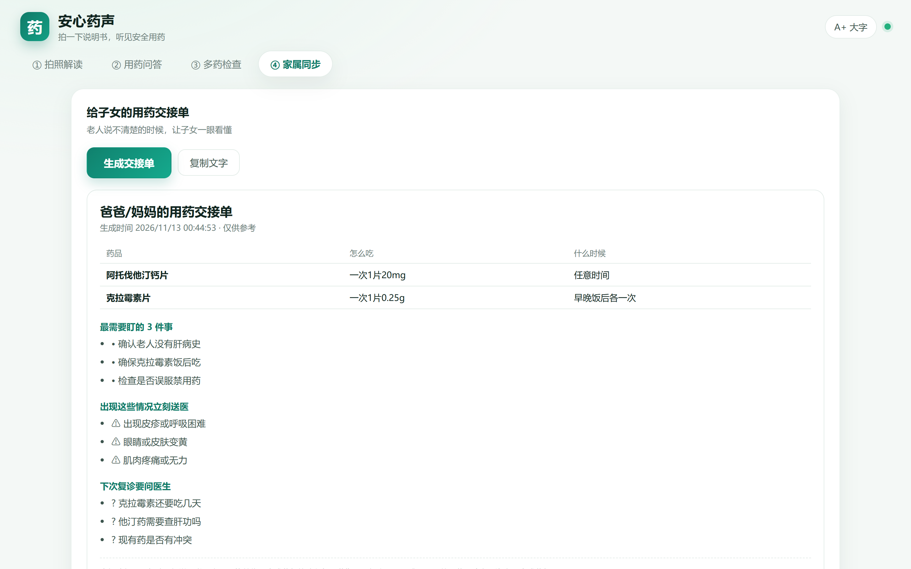

# 02 · 产品定义与交互设计

> 文档定位：赛题「技术路线第 2 步 · 产品定义与交互设计」的交付物。
> 对应代码：`web/`（前端）、`app/main.py`（接口）。

---

## 1. 产品定位

| 项 | 内容 |
| --- | --- |
| 一句话 | 拍一下说明书，听见安全用药 |
| 形态 | Web 应用（手机/平板/电脑均可），无 App 安装门槛 |
| 核心用户 | 60+ 慢病多重用药老人（使用者）+ 异地子女（付费者） |
| 核心价值 | 把「看不懂的说明书」变成「听得懂的一句话」，并在多药同服时主动报警 |
| 差异点 | 语音优先 · 引用可溯源 · 多药冲突分级 · 家属协同 |

### 产品原则（写在代码之前的三条）

1. **宁可说「不知道」，也不能猜。** 医疗场景里，错误答案的代价远高于没有答案。
2. **老人不需要学习。** 不注册、不登录、不选菜单，进来就是「拍照」。
3. **每句话都能被验证。** 任何 AI 生成的结论，必须能点开看到说明书原文。

---

## 2. 信息架构

```
安心药声（单页应用，4 个一级 Tab）
├── ① 拍照解读
│   ├── 上传区（拍照 / 相册 / 粘贴文字）
│   ├── 示例入口（3 种常见药）
│   ├── 结构化结果（11 个字段，按章节分组）
│   └── 语音播报（播放器 + 逐段高亮文稿）
├── ② 用药问答
│   ├── 快捷问题（6 个高频问法）
│   ├── 对话区（回答 + 引用 chip + 就医提示）
│   └── 右侧 Agent 过程（工具调用 trace）
├── ③ 多药检查
│   ├── 用药清单（增删）
│   ├── 冲突结果（四级色标 + 机制/后果/处置）
│   └── 服药时间冲突提示
└── ④ 家属同步
    └── 交接单（用药表 / 盯什么 / 送医信号 / 复诊问题）
```

---

## 3. 核心业务流程

```mermaid
flowchart TD
    A[老人/子女 拍说明书] --> B{图片可读?}
    B -- 否 --> A1[提示重拍 / 改为粘贴文字]
    A1 --> A
    B -- 是 --> C[VLM 结构化解析<br/>11 字段 + evidence]
    C --> D{置信度 >= 0.75?}
    D -- 否 --> D1[提示重拍 或 转药师人工]
    D -- 是 --> E[生成四段式播报稿]
    E --> F[数字白名单校验]
    F --> G[TTS 合成<br/>数字转中文/慢速]
    G --> H[老人收听]
    H --> I{有疑问?}
    I -- 是 --> J[Agent 决定调哪个工具]
    J --> K[BM25 检索 / 相互作用 KB / 老年常识]
    K --> L[受约束生成 + [n] 引用]
    L --> M[四道护栏 + 独立复核]
    M --> N[可信回答]
    H --> O[加入用药清单]
    O --> P[多药冲突分级]
    P --> Q[生成家属交接单]
```

---

## 4. 功能清单（含实现状态）

### 4.1 Must have（v1.0 已实现）

| 编号 | 功能 | 说明 | 状态 |
| --- | --- | --- | --- |
| F01 | 拍照/相册上传 | 支持 JPG/PNG，手机直接调用相机 | ✅ |
| F02 | 说明书结构化 | 11 字段 + 每字段 evidence 原文 | ✅ |
| F03 | 置信度提示 | <75% 提示重拍或转人工 | ✅ |
| F04 | 四段式播报稿 | 治什么/怎么吃/当心什么/何时就医 | ✅ |
| F05 | 语音合成与播放 | 慢速（-12%）、可调速、逐段高亮 | ✅ |
| F06 | 有据问答 | 答案带 [n]，点击查看原文 | ✅ |
| F07 | 拒答与就医提示 | 停药/换药/加量/诊断一律转医生 | ✅ |
| F08 | 多药冲突检查 | 四级分级 + 机制/后果/处置 | ✅ |
| F09 | 家属交接单 | 用药表 + 盯什么 + 送医信号 | ✅ |
| F10 | Agent 过程可视化 | 工具名、入参、返回、耗时 | ✅ |

### 4.2 Should have（已预留，v1.1）

| 编号 | 功能 | 说明 |
| --- | --- | --- |
| F11 | 用药提醒 | 工具 `set_med_reminder` 已实现，缺推送通道 |
| F12 | 大字模式持久化 | 目前仅当前会话生效 |
| F13 | 历史记录 | 内存态，需落库 |
| F14 | 多语言/方言 | edge-tts 已支持粤语/川渝音色 |

### 4.3 Won't have（明确不做）

| 功能 | 原因 |
| --- | --- |
| 在线问诊 / 开处方 | 需要《互联网诊疗许可证》，合规成本极高 |
| 药品购买 / 推荐替代药 | 商业与合规双重风险 |
| 疾病诊断 | 超出「信息无障碍工具」定位 |
| 通用健康问答 | 会稀释「说明书翻译官」的定位 |

---

## 5. 关键界面与交互细节

### 5.1 拍照解读页



| 交互点 | 设计决策 | 原因 |
| --- | --- | --- |
| 上传区占屏 60% | 首屏只有一件事：拍照 | 降低认知负荷 |
| 示例入口常驻 | 无需拍照即可体验 | 演示与试用门槛 |
| 结果按「禁忌/相互作用」标红 | 危险信息用红色块 | 老人对颜色比对文字敏感 |
| 置信度徽标 | 96% / 低于 75% 变橙 | 让不确定性可见 |

### 5.2 语音播报



- 播放器固定三段：播放键（54px）、进度条、语速选择。
- 文稿分 4 段卡片，播到哪段高亮哪段——**让「听不清」的人可以「看」**。
- 底部常驻免责声明，不可关闭（合规要求）。

### 5.3 用药问答 + Agent 过程



- 回答气泡内：正文 + 引用 chip + 就医提示（红色条）。
- 右侧 trace：工具名 + 耗时 + 入参/返回，**把黑盒打开给评审看**。
- 引用 chip 的 `title` 属性是原文，鼠标悬停即见。

### 5.4 多药检查



- 顶部药盒 chip 可增删；两种以上才能检查。
- 结果卡：药名对 + 等级色标 + 三行（为什么打架 / 可能后果 / 该怎么做）+ 依据编号。
- 时间冲突单独一条橙色提示区。

### 5.5 家属交接单



- 表格化用药清单（药名/怎么吃/什么时候）。
- 三个清单：盯什么、送医信号、问医生什么。
- 一键复制为纯文本，可直接发微信给家人。

---

## 6. 适老化设计规范

| 维度 | 规范 | 实现 |
| --- | --- | --- |
| 字号 | 正文 ≥16px，可一键切 19px | `--fs` CSS 变量 + `body.big` |
| 对比度 | 正文对比度 ≥ 7:1 | 墨绿 #10241F on #F4F8F6 |
| 触控区 | 主按钮 ≥ 44×44px | 播放键 54px、主按钮 13×26 padding |
| 句子长度 | 播报稿每句 ≤20 字 | Prompt 硬约束 + 数字校验 |
| 语速 | 默认 -12%，可 0.75×~1.25× | edge-tts rate + `playbackRate` |
| 声音 | 女声、温和、无背景音 | zh-CN-XiaoxiaoNeural |
| 颜色语义 | 红=禁忌/危险，橙=注意，绿=安全 | 全局统一 |
| 免责 | 每个 AI 输出页常驻 | `config.DISCLAIMER` |

---

## 7. 异常与空状态

| 场景 | 处理 |
| --- | --- |
| 未上传就点「听说明书」 | toast「请先上传说明书」 |
| 图片模糊 | 置信度 <75% 变橙 + 提示重拍/转药师 |
| 大模型超时/限流 | 指数退避重试 4 次；仍失败返回 502 + 友好文案，**不产生幻觉答案** |
| 证据不足 | 明确回答「说明书里没写，建议问药师」，不猜 |
| 问题涉及停药/换药 | 拒绝判断 + 解释为什么 + 引导就医 |
| 空结果 | 「这张说明书没有识别出结构化内容，请换一张更清晰的图片」 |

---

## 8. 接口与前端映射

| 前端动作 | 接口 | 关键返回字段 |
| --- | --- | --- |
| 上传图片 | `POST /api/parse` | `label.drug_name` / `label.dosage[]` / `label.confidence` |
| 点示例 | `POST /api/demo/{id}` | 同 parse |
| 听说明书 | `POST /api/explain` | `script.segments[]` / `audio.url` |
| 提问 | `POST /api/ask` | `answer` / `citations[]` / `guard.pass` |
| Agent 提问 | `POST /api/agent` | `answer` / `trace[]` / `reminders[]` |
| 多药检查 | `POST /api/interactions` | `overall_level` / `findings[]` |
| 家属单 | `POST /api/family` | `medications[]` / `watch_list[]` |

---

## 9. 验收标准（Acceptance Criteria）

| 编号 | 验收项 | 标准 | 实测 |
| --- | --- | --- | --- |
| AC1 | 拍照到出结果 | ≤ 15 秒 | 约 4~8 秒 |
| AC2 | 播报可听 | 生成 mp3 且可播放 | ✅ |
| AC3 | 问答带引用 | 引用覆盖率 ≥ 90% | 90% |
| AC4 | 危险问题不越界 | 拦截率 100% | 100% |
| AC5 | 多药检查 | 输出四级分级 + 依据 | ✅ |
| AC6 | 家属单可复制 | 一键复制成功 | ✅ |
| AC7 | 无 Key 时可用 | 页面可打开，给出明确提示 | ✅ |

---

## 10. 后续迭代（产品视角）

| 版本 | 主题 | 关键点 |
| --- | --- | --- |
| v1.1 | 从「能听」到「能记」 | 用药提醒推送、历史记录落库、方言语音 |
| v1.2 | 从「拍说明书」到「拍药盒」 | 条码/追溯码识别，对接国家药品编码 |
| v1.3 | 从「个人」到「协同」 | 药师复核工单、药店/家庭医生协作台 |
| v2.0 | 从「说明书」到「慢病」 | 血压/血糖记录与用药联动（严格合规前提下） |
